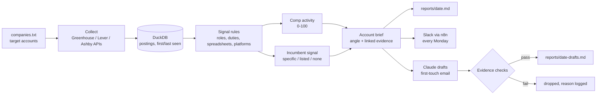
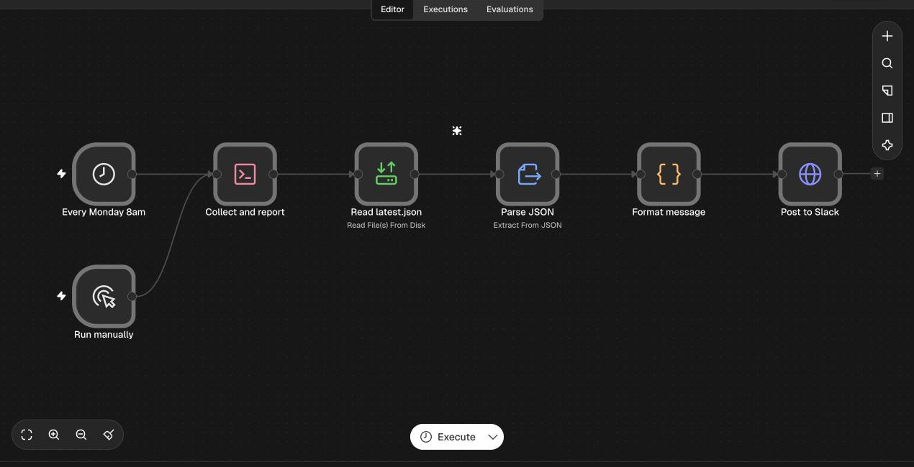

# CompSignal

**Find the companies whose sales-commission operation is changing right now, with the evidence linked.**

CompSignal scans target companies' public job boards every week. It flags explicit signs of sales-compensation
activity, such as a new Commissions Manager role, a named compensation platform, or commission work run in
spreadsheets. For each flagged account it writes a short brief that links every claim to the posting it came from.

Built for a sales-compensation software team (Everstage's outbound motion).
Tools used: Python, Claude (Anthropic API), DuckDB (SQL), n8n, Slack, and the Greenhouse, Lever and Ashby APIs.

## The problem

Outbound reps at a sales-compensation vendor start each week with a long account list and little reason to
choose one company over another.

- **The buyer is rare.** Usually one Comp, RevOps or Finance person owns commissions, so firmographics such as
  size or industry say little about who is ready to buy.
- **Timing matters more than fit.** The best moment to reach out is when a company is building or rebuilding its
  comp function: hiring for it, moving off spreadsheets, or changing platforms.
- **Research is manual.** Finding that moment means reading career pages one company at a time, and the
  findings rarely get written down where the next rep can reuse them.

## The solution

Job postings are public, current and specific. A company hiring a *Senior Commissions Manager* that requires
"plan logic in Xactly" is telling you what it is working on. CompSignal reads these postings at scale and turns
them into a ranked, evidence-backed list.



The design choices:

1. **Evidence before outreach.** Every line in a brief links to its source posting, so a rep can check a claim
   in seconds and disagree with it.
2. **Rules, not black-box judgement.** Signals come from tested pattern rules, so any score can be explained
   and challenged. This keeps the output auditable for GTM leaders.
3. **Two scores instead of one.** *Comp activity* measures how much comp work is happening. The *incumbent signal*
   records which platform the company runs, if a posting names one. Keeping them separate lets a rep choose the
   pitch: help a team that is building the function, or position against a competitor.
4. **"Specific" vs "listed" platforms.** "Plan logic in Xactly" points to a platform the company runs. "Experience
   with Xactly, CaptivateIQ or Spiff" only lists acceptable skills. CompSignal tells the two apart, so reps don't
   pitch a displacement on weak evidence.
5. **Customer-aware.** If a posting names Everstage, the brief says to check the CRM before reaching out, so
   current customers don't get cold outreach.
6. **Change tracking.** DuckDB stores when each posting was first seen, so the weekly run marks new evidence as **(new)**.
7. **Claude writes the draft, and code checks it.** Claude turns each brief's evidence into a first-touch email
   that the rep can edit, and returns it as structured JSON with the URLs it relied on. Code then checks every
   draft before a rep sees it:
   - it cites at least one evidence URL, and every cited URL belongs to that account;
   - it names a platform only when the incumbent signal is "specific";
   - its length is within limits.

   A draft that fails a check is dropped and the reason is logged. Known customers and weak signals are skipped
   before any call is made. Rules still decide who is flagged, and Claude only writes the outreach.

## Results (postings collected 16 Nov 2026)

| | |
|---|---|
| Companies scanned | 250 targets. 150 had a job board reachable through the official APIs |
| Accounts flagged | 14, each with a brief and linked evidence ([full report](reports/2026-11-18.md)) |
| Specific platform in use | Okta, MongoDB, Elastic, Collibra and Rubrik (Xactly) |
| Customer check | Notion (a known Everstage customer) is caught by its own posting and marked "do not cold-prospect" |
| Claude drafts | 8 first-touch emails for the top 10 accounts. All 8 passed the evidence checks, and the 2 likely customers were skipped ([drafts](reports/2026-11-18-drafts.md)) |
| Extraction precision | **89%** across 64 hand-checked flags (see [Evaluation](#evaluation)) |

### Sample brief (abridged, real output)

> ### Okta
> - Comp activity: **60/100** | Incumbent-tool signal: **specific** (Xactly)
> - Suggested angle: Hiring a comp specialist whose posting expects Xactly experience. Open by asking what is driving the hire (plan changes outpacing tooling?) and offer a side-by-side on admin time and payout accuracy.
> - Evidence:
>   - Comp role: [Senior Commissions Manager](https://www.okta.com/company/careers/opportunity/8155512?gh_jid=8155512)
>   - Comp role: [Senior Manager, GTM Compensation Strategy & Incentive Design](https://www.okta.com/company/careers/opportunity/8132596?gh_jid=8132596)
>   - Names Xactly: [Senior Commissions Manager](https://www.okta.com/company/careers/opportunity/8155512?gh_jid=8155512): "Operationalize data reconciliations between upstream source systems (CRM and Workday) and Xactly Incent..."

### Sample Claude draft (real output, unedited)

> **Subject:** Your Senior Sales Compensation Engineer role
>
> Hi,
>
> Saw MongoDB is hiring a Senior Sales Compensation Engineer, someone to be the in-house expert on commissions processing, the Xactly product suite, and how each commission plan component runs inside it.
>
> When a team needs a dedicated engineer to own how plans are configured, that work often keeps growing as plans change. Everstage is a sales commission platform built so comp and RevOps teams can set up and adjust plan logic themselves, with less reliance on specialist configuration work.
>
> Would it be useful to compare how your team handles plan changes in Xactly today with how that would work in Everstage?
>
> *Evidence used: [Senior Sales Compensation Engineer](https://www.mongodb.com/careers/job/?gh_jid=8121701)*

The draft can name Xactly because MongoDB's incumbent signal is "specific". For accounts where platforms appear
only in a list (Stripe, ClickUp), the drafts name no platform.

### Scoring rules

| Evidence | Effect |
|---|---|
| Comp-specific role title (Commissions Manager, Sales Compensation Analyst) | 40 points, +10 per extra role (max +20) |
| Commission duties inside another role's description | +10 each (max +30) |
| Spreadsheet and commissions in the same sentence | +20 |
| Exactly one platform named in context ("plan logic in Xactly") | incumbent signal: **specific** |
| Platforms named only in a list ("such as A, B or C") | incumbent signal: **listed** |

The comp activity score is capped at 100.

## Evaluation

Each flag was checked against its source posting. Unit tests cover the signal rules and the draft checks
(`pytest`: 20 passing). The draft tests use a stand-in for the API, so they need no key and no network.

| Check | Result (95% interval) |
|---|---|
| Extraction correct, all signals (2 samples) | **57/64 = 89%** (79-95%) |
| Comp-role titles | **12/12 = 100%** (76-100%) |
| "Specific vs listed" flag agrees with the reviewer | **13/14 = 93%** (69-99%) |
| Platform mentions that name a platform the company actually runs | 11/39 = 28% (17-44%) |

What the evaluation changed:
- Only about 1 in 4 platform mentions shows the platform a company actually runs. Most are lists of acceptable
  skills. This finding led to the specific/listed split, so displacement pitches use only the strong cases.
- Commission-duty wording was the noisiest rule, because accounting roles that mention deferred commissions also
  matched. The rule now excludes accounting language, and tests cover those cases.

Labelled samples and the scoring script are in [`eval/`](eval/). To re-measure on fresh data:

```
.venv/bin/python -m compsignal sample --n 40 --exclude eval/labels.json   # label eval/labels.json
.venv/bin/python -m compsignal score-labels
```

## Quick start (5 minutes)

Needs Python 3.10+ and git. No API keys are required.

```
git clone https://github.com/Abitha-Rao/compsignal.git
cd compsignal
python3 -m venv .venv
.venv/bin/pip install -r requirements.txt
.venv/bin/python -m compsignal collect --limit 20   # quick trial on 20 companies; drop --limit for all
.venv/bin/python -m compsignal report
```

On Windows, use `py -m venv .venv` and `.venv\Scripts\python` in place of `.venv/bin/python`.

| Output | What it is |
|---|---|
| `reports/<date>.md` | Readable briefs, highest-scoring accounts first |
| `reports/latest.json` | The same results as JSON for automation (n8n, CRM import) |
| `data/compsignal.duckdb` | All collected postings with first and last seen dates. Query it with SQL |

To have Claude write first-touch emails for the top 10 accounts (needs an
[Anthropic API key](https://console.anthropic.com/)):

```
export ANTHROPIC_API_KEY=...                       # keep it out of the repo
.venv/bin/python -m compsignal draft --top 10      # writes reports/<date>-drafts.md
```

Other commands: `report --min-score 60` keeps only stronger accounts, `report --slack` posts to Slack, and
`.venv/bin/python -m pytest -q` runs the tests.

### Weekly automation (n8n)

[`n8n/compsignal-weekly.json`](n8n/compsignal-weekly.json) runs collect and report every Monday at 8am, or on
demand. It then reads `latest.json` and posts the top 10 accounts to Slack.



n8n 2.x disables the Execute Command node by default. Start n8n with these flags, and replace `/Users/YOU` in
the workflow with your path:

```
NODES_EXCLUDE="[]" N8N_RESTRICT_FILE_ACCESS_TO=$PWD N8N_BLOCK_ENV_ACCESS_IN_NODE=false npx n8n
```

## Set it up for your team

1. **Choose your target accounts.** Put one job-board name per line in `companies.txt`. Lines that start with
   `#` are comments. To find a company's name, open its careers page and look at the job links:
   `boards.greenhouse.io/okta` or `job-boards.greenhouse.io/okta` → `okta`, `jobs.lever.co/acme` → `acme`,
   `jobs.ashbyhq.com/notion` → `notion`. Names that do not match a board are skipped. You can export the list
   from your CRM, one name per line.
2. **Connect Slack (optional).** In Slack, create an app with *Incoming Webhooks* turned on, add it to a
   channel, and copy the webhook URL. Set it as an environment variable on the machine that runs CompSignal:
   `export SLACK_WEBHOOK_URL=https://hooks.slack.com/...`. Keep it out of the repo.
3. **Schedule it.** Run it on a machine that is always on, such as a small cloud VM or a shared ops server,
   so the Monday run happens without anyone's laptop. Either:
   - import `n8n/compsignal-weekly.json` into a self-hosted n8n (steps below), or
   - add a cron job: `0 8 * * 1 cd /path/to/compsignal && .venv/bin/python -m compsignal collect && .venv/bin/python -m compsignal report --slack`
4. **Use the output.** Reps read the Slack summary and the brief in `reports/`. To load results into
   Salesforce or HubSpot, import `reports/latest.json`, or add an HTTP node to the n8n workflow.
5. **Keep it accurate.** About once a month, run `sample`, check the flagged items against their postings, and
   run `score-labels`. Signal rules live in `compsignal/signals.py`. Each rule has tests in `tests/`.

## Repository map

| Path | Purpose |
|---|---|
| `compsignal/collect.py` | Job-board API clients (Greenhouse, Lever, Ashby) |
| `compsignal/signals.py` | Signal rules and evidence snippets |
| `compsignal/score.py` | Comp activity score and incumbent signal |
| `compsignal/brief.py` | Account briefs with suggested angles |
| `compsignal/draft.py` | Claude first-touch drafts and evidence checks |
| `compsignal/store.py` | DuckDB storage and first-seen tracking |
| `compsignal/evaluate.py` | Precision with Wilson intervals |
| `n8n/` | Weekly workflow |
| `eval/` | Labelled samples |
| `reports/` | Latest output |

## Next steps

- **CRM sync:** push briefs to HubSpot or Salesforce as account notes and tasks, and skip accounts that are
  already customers or in active deals.
- **Outcome loop:** compare reply and meeting rates for flagged and unflagged accounts, then reweight the
  scoring from those results.
- **More sources:** add Workday and SmartRecruiters boards to widen coverage beyond the three supported APIs.

## Responsible use

Uses only the official public job-board APIs. It identifies itself and rate-limits its requests. It stores
company names and public posting text, and no personal data. A flag is a lead for a person to check.
